<div align="center">

# BookRAG

**Multimodal retrieval-augmented generation over books, papers and PDFs**

Embed text and images into *one* shared vector space, index them in ChromaDB,
and query in whichever modality you have — a sentence finds a figure, a figure
finds its paragraph.

[](https://www.python.org/)
[](LICENSE)
[](#testing--verification)
[](#testing--verification)
[](#choosing-a-checkpoint)
[](#how-it-works)

</div>

---

## Contents

- [What makes it different](#what-makes-it-different)
- [Architecture — the Accelerator](#architecture--the-accelerator)
- [Install](#install)
- [Quick start](#quick-start)
- [CLI reference](#cli-reference)
- [Python API](#python-api)
- [How it works](#how-it-works)
- [Configuration](#configuration)
- [Choosing a checkpoint](#choosing-a-checkpoint)
- [Monitoring](#monitoring)
- [Testing & verification](#testing--verification)
- [Project layout](#project-layout)
- [Troubleshooting](#troubleshooting)

---

## What makes it different

| | |
| --- | --- |
| **One space, two modalities** | Both checkpoints are true dual encoders: a text query returns the *figure* that illustrates it, and an image query returns the *paragraph* that explains it. No captioning model sits in the middle. |
| **Asymmetric retrieval, done right** | Documents are indexed bare, queries are marked as queries — as CLIP v2 task instructions or as v5-omni's `Query:` / `Document:` role prefixes, driven by the same two settings. |
| **Checkpoint safety** | Both models emit 1024-d vectors, so a mixed index fails *silently and plausibly*. BookRAG stamps each collection with its checkpoint and refuses any mismatch. |
| **Zero-infrastructure storage** | ChromaDB on disk, cosine space, content-hash ids — re-ingesting an unchanged file is idempotent, and no server is ever running. |
| **Runs on what you have** | `auto` picks CUDA → Intel XPU → MPS → CPU, with bf16 where it is supported and fp32 where it is not. Verified on an Intel Arc 140T. |
| **Honest instrumentation** | Every stage is timed, the model's device/dtype/API is captured once per run, and monitoring is best-effort — it can never raise or change control flow. |

---

## Architecture — the Accelerator

`src/bookrag/accelerator/embedder.py` is where the machine learning actually
happens: it resolves *where* the model runs, *how* it is loaded, *which*
embedding API the checkpoint exposes, and *how* each modality is encoded.
Everything outside it (`store.py` → `retriever.py` → `pipeline.py` → `cli.py`)
is orchestration.

```mermaid
flowchart TB

    subgraph CFG["CONFIG — AppSettings (Rag_app/settings.py), overridable per run with --model"]
        direction LR
        C1["model_id<br/>jinaai/jina-embeddings-v5-omni-small"]
        C2["device = auto<br/>dtype = auto<br/>batch_size = 16<br/>max_text_length = 512"]
        C3["query_task = retrieval.query<br/>index_task = empty<br/>trust_remote_code = true"]
    end

    ENTRY["ClipEmbedder.embed_texts() / embed_images()<br/>torch + transformers imported lazily on first use"]

    subgraph LOAD["1 — LOAD · stage model.load (a leaf timer; it also covers the cold imports)"]
        direction TB
        L1["resolve_device()<br/>auto picks cuda, then xpu, then mps, then cpu"]
        L2["resolve_dtype(device)<br/>bfloat16 when CUDA/XPU reports bf16 support,<br/>float32 everywhere else"]
        L3{"_is_omni_model(model_id)?"}
        L4["_resolve_source()<br/>a materialised local copy under<br/>LOCALAPPDATA/BookRAG/models/NAME if present,<br/>otherwise the HuggingFace repository id"]
        L5["AutoModel.from_pretrained(source,<br/>trust_remote_code = true,<br/>modality = vision for omni — drops the audio tower)"]
        L6["_materialise() on failure:<br/>snapshot_download into plain files<br/>(Windows cannot write the HF symlink cache)<br/>then retry from there"]
        L7["_cast(dtype) then .to(device).eval()"]
        L8["_detect_api() — records which API this checkpoint exposes"]
        ERR1["ModelUnavailableError<br/>carries an install hint"]
    end

    subgraph API["2 — API DETECTION · newest first; the embed branch is deliberately last so every existing checkpoint resolves exactly as before"]
        direction TB
        D1{"encode_text + encode_image?"}
        D2{"get_text_features + get_image_features?"}
        D3{"get_text_embeddings + get_image_embeddings?"}
        D4{"model.embed?"}
        R1["api = encode — CLIP v2"]
        R2["api = features"]
        R3["api = embeddings"]
        R4["api = embed — v5-omni"]
        D1 -->|"yes"| R1
        D1 -->|"no"| D2
        D2 -->|"yes"| R2
        D2 -->|"no"| D3
        D3 -->|"yes"| R3
        D3 -->|"no"| D4
        D4 -->|"yes"| R4
        D4 -->|"no"| ERR2["ModelUnavailableError"]
    end

    subgraph ENC["3 — ENCODE · stage embed.text / embed.image, kept as sibling leaf timers"]
        direction TB
        MOD{"input modality"}
        PROC["_processor_or_fail() — built on demand<br/>CLIP: AutoProcessor.from_pretrained<br/>omni: hand-assembled Qwen3VLProcessor<br/>(tokenizer, image_processor, Qwen3VLVideoProcessor)<br/>the auto video registry does not know jina_embeddings_v5_omni"]
        T1["CLIP text — _resolve_task() checks retrieval.query<br/>against the model instruction table first,<br/>then encode_text(batch_size, max_length)"]
        T2["CLIP image — encode_image(batch_size)"]
        O1["omni text — the role prefix is applied here:<br/>task set means search, so Query: prefix<br/>no task means index, so Document: prefix<br/>then processor, then model.embed()"]
        O2["omni image — image_token is read from the processor,<br/>never guessed: a wrong token encodes as unk and<br/>silently returns identical vectors for every image<br/>one text slot per image, padding = true, then model.embed()"]
        F1["fallbacks — processor then<br/>get_text_features / get_image_embeddings"]
        MOD -->|"text · api encode"| T1
        MOD -->|"image · api encode"| T2
        MOD -->|"any · api embed"| O1
        MOD -->|"image · api embed"| O2
        MOD -->|"any · api features or embeddings"| F1
        PROC -.->|"omni path builds it first"| O1
        PROC -.->|"omni path builds it first"| O2
    end

    NORM["l2_normalise()<br/>(n, 1024) float32, unit length — cosine in ChromaDB then equals the dot product"]
    MON["monitor.set_model(id, device, dtype, api, load_s, parameters, peak RSS)<br/>written to monitoring.log — best effort, never raises"]
    OUT["→ store.py — ChromaDB collection with hnsw:space = cosine<br/>and bookrag:model_id recorded as the collection fingerprint"]

    CFG -.-> ENTRY
    ENTRY --> L1 --> L2 --> L3
    L3 --> L4 --> L5
    L5 -.->|"cannot load"| L6
    L6 -.->|"retried from the plain copy"| L5
    L5 -->|"load failed twice"| ERR1
    L5 --> L7 --> L8
    L8 --> D1
    R1 --> MOD
    R2 --> MOD
    R3 --> MOD
    R4 --> MOD
    T1 --> NORM
    T2 --> NORM
    O1 --> NORM
    O2 --> NORM
    F1 --> NORM
    NORM --> OUT
    L8 -.-> MON
```



Points worth knowing, because each one exists for a reason that is easy to
re-break:

- **`model.load` and `embed.*` are siblings.** The embedders call `self.load()`
  *outside* the `embed.*` timers, so the same wall-clock is never billed twice
  and the coverage figure stays honest.
- **The `embed` API branch is checked last.** CLIP v2 resolves through
  `encode_text`/`encode_image` exactly as it did before v5-omni existed.
- **The omni processor is assembled by hand.** `transformers` 4.57's auto video
  registry does not recognise `model_type: jina_embeddings_v5_omni`; deleting
  `video_preprocessor_config.json` does not fix it.
- **The image token comes from the processor.** Guessing it yields `<unk>`,
  which produces identical vectors for every image *without raising* — the one
  silent failure mode this module refuses to have.
- **Normalisation happens on the way out, defensively.** ChromaDB's cosine
  space is only equivalent to a dot product while every vector is unit length.

---

## Install

```bash
# Python 3.10+ is required
python -m venv .venv
.venv\Scripts\activate          # Windows
# source .venv/bin/activate     # macOS / Linux

pip install -r requirements.txt
pip install -e .                # installs the `bookrag` command
```

The default checkpoint (~3.1 GB, ~1.7 GB for CLIP v2) downloads on first use.
`bookrag doctor` reports exactly what is installed, which device was selected
and where the cache lives.

---

## Quick start

```bash
bookrag doctor                          # environment, device, model cache
bookrag ingest ./my_book.pdf            # index a PDF, TXT or Markdown file
bookrag query "What is the equation for kinetic energy?"
bookrag find-image ./scratch/figure.png # search by image instead of text
bookrag stats                           # what is indexed
```

No entry point on PATH? Use the module form: `python -m bookrag query "..."`.

```bash
bookrag demo        # build a tiny synthetic book and search it end to end
```

> **The first run is slow.** The checkpoint downloads and is then reloaded on
> every CLI invocation (≈12 s on XPU for v5-omni, ≈22 s for CLIP v2). For many
> queries in one session, use the [Python API](#python-api) — the model loads
> once.

---

## CLI reference

| Command | Purpose |
| --- | --- |
| `bookrag doctor` | Report Python version, packages, device, model cache, data dir. |
| `bookrag ingest <path>` | Index a file or directory. Options: `--no-images`, `--no-recursive`, `--keep-old`, `--json`. |
| `bookrag query <text>` | Text search. Options: `-k/--top-k`, `-t/--type text\|image`, `-s/--source`, `--json`. |
| `bookrag find-image ` | Image search with the same filter options. |
| `bookrag demo` | Self-contained smoke test. |
| `bookrag stats` | Record counts per type and per source. |
| `bookrag reset` | Clear the collection (prompts unless `-y`). |
| `bookrag settings` | Show configuration. `--set KEY=VALUE`, `--save` to persist. |

Global flags, accepted before *or* after the subcommand:

| Flag | Effect |
| --- | --- |
| `--model <id>` | Use a different checkpoint for this run only — no settings change. |
| `--profile` | Print stage timings and model runtime when the command finishes. |
| `--json` | Machine-readable output (the profile report moves to stderr). |
| `-v/--verbose` | Debug logging. |

```bash
bookrag --profile query "..." -k 8
bookrag query "..." --profile --json | jq '.results[].score'
bookrag query "..." --model jinaai/jina-clip-v2
```

---

## Python API

```python
from bookrag import BookRagPipeline

pipeline = BookRagPipeline.from_environment()   # model loads once, on first use

report = pipeline.ingest_document("book.pdf")
print(report.text_chunks, report.images, report.pages)

for hit in pipeline.search_text("What is the equation for kinetic energy?", top_k=5):
    print(f"{hit.score:.3f}  {hit.kind:6}  p.{hit.page}  {hit.document[:80]}")

for hit in pipeline.search_image("scratch/figure.png", top_k=5):
    print(hit.score, hit.metadata)

hits = pipeline.search(text="phase diagram", image="scratch/figure.png", top_k=5)
```

Types you will meet:

- `SearchHit` — `id`, `score` (1 − cosine distance), `distance`, `document`,
  `metadata`, plus convenience properties `kind`, `page`, `source`.
- `IngestReport` — `source`, `text_chunks`, `images`, `skipped_images`,
  `pages`, `errors`.

---

## How it works

```
book.pdf ──► PyMuPDF ──┬─► text  ──► normalise ──► chunk ──► Jina text encoder       ─┐
                       │                              (overlapping chunks)           │
                       └─► images ──► filter/scale ────────────────────────────────┤
                                                                                  ▼
                                                                         1024-d unit vector
                                                                                  ▼
                                                         ChromaDB collection (cosine)
                                                                                  ▼
                            query text  ──► same encoder ──► nearest neighbours ◄──┘
                            query image ──► same encoder ──► nearest neighbours
```

**Chunking.** Text is normalised, split on paragraph seams, then sentence
seams, and packed into overlapping chunks (1200 chars, 150 overlap by default)
so context survives the boundaries.

**Image filtering.** Decorative artefacts — bullets, rules, logos — are
dropped by pixel-area and minimum-dimension heuristics before embedding.

**Idempotency.** Every record id is `SHA-256(kind|source|page|content)`.
Re-ingesting upserts the same ids, and the source's previous records are
deleted first so an edited file never leaves stale chunks behind.

**Scores.** ChromaDB reports cosine *distance*; BookRAG surfaces
`score = 1 − distance`, so `1.0` means identical.

**Asymmetric retrieval.** Documents are embedded bare, queries are marked as
queries, and both checkpoints are served by the same two settings:

| | CLIP v2 | v5-omni |
| --- | --- | --- |
| Query | `retrieval.query` instruction table | `Query: ` prefix |
| Document | no instruction (`index_task` empty) | `Document: ` prefix |
| Settings | `query_task` non-empty, `index_task` empty | identical — no change needed to switch |

---

## Configuration

Settings live in `%LOCALAPPDATA%\BookRAG\settings.json` (Windows),
`~/.local/share/BookRAG` (Linux) or `~/Library/Application Support/BookRAG`
(macOS). Override the location with `BOOKRAG_HOME`.

| Setting | Default | Meaning |
| --- | --- | --- |
| `model_id` | `jinaai/jina-embeddings-v5-omni-small` | HuggingFace model id. |
| `device` | `auto` | `auto`, `cpu`, `cuda`, `cuda:1`, `xpu` (Intel Arc), `mps`. |
| `dtype` | `auto` | `auto` = bf16 on CUDA/XPU, fp32 on CPU; or `float32`, `float16`, `bfloat16`. |
| `trust_remote_code` | `true` | Jina ships custom modelling code; required. |
| `max_text_length` | `512` | Tokens fed to the text tower. |
| `query_task` | `retrieval.query` | Instruction/role used for **queries**. |
| `index_task` | *(empty)* | Instruction/role used for **documents**. |
| `collection_name` | `book_chunks` | ChromaDB collection. |
| `hnsw_space` | `cosine` | `cosine`, `l2` or `ip`. |
| `top_k` | `5` | Default number of results. |
| `chunk_size` | `1200` | Characters per chunk. |
| `chunk_overlap` | `150` | Overlap between chunks. |
| `batch_size` | `16` | Items per forward pass; v5-omni measures best at `32` on XPU. |
| `extract_images` | `true` | Extract embedded images from PDFs. |
| `keep_extracted_images` | `true` | Persist extracted images to disk. |
| `min_image_pixels` | `4096` | Drop images smaller than this area. |
| `max_image_side` | `1024` | Downscale images before embedding. |

Every setting has an environment-variable twin, `BOOKRAG_<KEY>`:

```bash
BOOKRAG_TOP_K=10 BOOKRAG_DEVICE=cpu bookrag query "..."
bookrag settings --set top_k=10 --set device=cpu --save
```

### Log routing

Logs are the one thing allowed to live outside the data directory, so a book,
its database and its logs can sit together in a checkout:

| Directory | Chosen when |
| --- | --- |
| `$BOOKRAG_LOG_DIR` | Always wins, if set. |
| `<data dir>/logs` | `BOOKRAG_HOME` is set — the hermetic mode the test suite uses. |
| `<project>/Log` | Running from a source checkout. |
| `<data dir>/logs` | Installed as a package — no project folder to write into. |

Two files: `bookrag.log` (prose, warnings, errors) and `monitoring.log`
(one machine-readable `key=value` record per line).

---

## Choosing a checkpoint

BookRAG defaults to `jinaai/jina-embeddings-v5-omni-small`, Jina's successor to
CLIP v2 — the same 1024-dimensional shared space, quicker to load and quicker
at both modalities. `jinaai/jina-clip-v2` remains fully supported.

Measured on an Intel Arc 140T (XPU, bf16), batch size 32:

| | v5-omni-small | CLIP v2 |
| --- | --- | --- |
| Model load | 12.0 s | 22.0 s |
| Text throughput | 73.1 items/s | 28.8 items/s |
| Image throughput | 6.6 items/s | ~3.1 items/s |

Switch for a single run — accepted before or after the subcommand:

```bash
bookrag query "your question" --model jinaai/jina-clip-v2
```

### Why an index cannot be shared between checkpoints

Both checkpoints emit 1024-dimensional vectors. A collection built by one
loads happily under the other and returns confident, plausible and **wrong**
results — nothing in the vectors gives it away.

BookRAG records which checkpoint built each collection (`bookrag:model_id`)
and checks it in every command that reaches the store:

| Collection state | What happens |
| --- | --- |
| Recorded, and matching | Normal operation. |
| Recorded, and different | Refused, naming the checkpoint that built it. |
| Recorded nowhere, holding records | Refused — provenance is unknown. |
| Recorded nowhere, empty | Adopted and stamped with the current checkpoint. |

Move an index onto a new checkpoint by rebuilding it:

```bash
bookrag reset
bookrag ingest <path>
```

Keep an index exactly as it is by naming the checkpoint that built it —
supported on `ingest`, `query`, `find-image`, `demo`, `stats` and `reset`:

```bash
bookrag query "your question" --model jinaai/jina-clip-v2
```

---

## Monitoring

Every run records **how the model is running** and **how long each stage
took**, in `monitoring.log`, separate from `bookrag.log`:

```text
2026-10-24 14:11:50 MONITOR stage=parse.pdf took=0.049s bytes=773441 chunks=6 images=2
2026-10-24 14:11:52 MONITOR model id=jinaai/jina-embeddings-v5-omni-small device=xpu dtype=bfloat16 api=embed load_s=12.004
2026-10-24 14:12:11 MONITOR stage=embed.text took=0.187s api=embed items=1 rate=5.35/s
```

Or as a report:

```console
$ bookrag ingest examples/sample-book.pdf --profile
Model
------------------------------------------------------------------------
  checkpoint     jinaai/jina-embeddings-v5-omni-small
  device         xpu
  dtype          bfloat16
  api            embed
  load time      12.004s
Stage timings
------------------------------------------------------------------------
  stage                 calls      total       mean        max   items
  run.total                 1     8.412s     8.412s     8.412s       -
  ingest.total              1     7.983s     7.983s     7.983s       -
  model.load                1    12.004s    12.004s    12.004s       -
  embed.image               1     1.266s     1.266s     1.266s       2
  embed.text                1     0.114s     0.114s     0.114s       6
------------------------------------------------------------------------
  coverage           92.3%
```

**Containers vs leaves.** `run.total`, `ingest.total`, `ingest.store` and
`query.total` are containers — shown for context, excluded from the timed sum.
Everything else is a leaf and is summed into *timed work*; coverage is that
figure over wall-clock and is capped at 100%. A leaf never nests inside another
leaf, so the sum can never double-count.

Monitoring is **best-effort**: it never raises, never alters control flow, and
its lines never reach stdout, so `--json` stays parseable.

```python
from bookrag.monitoring import get_monitor

get_monitor().report()       # the table above
get_monitor().summary()      # JSON-serialisable dict
get_monitor().model_info     # device, dtype, api, parameters, memory, ...
```

---

## Testing & verification

The unit suite runs **without** torch, transformers or a real ChromaDB
install — `tests/fakes.py` provides an in-memory collection, a path-persistent
client and a deterministic hash embedder.

```bash
pip install -r requirements-dev.txt
pytest                       # 163 tests
pytest --cov=bookrag --cov-report=term-missing
ruff check src tests scripts && ruff format --check src tests scripts
```

Real libraries, real model — run manually, never part of pytest:

```bash
python scripts/verify_real_backends.py   # real ChromaDB + PyMuPDF
python scripts/verify_real_model.py      # the real Jina checkpoint (~3.1 GB)
python scripts/verify_fingerprint.py     # fingerprint refusals on real ChromaDB
python scripts/verify_e2e.py             # the installed CLI, end to end
```

`verify_e2e.py` is the strongest: it drives `bookrag` as a subprocess, the way
a user does, and asserts 25 checks against a known corpus — ingest totals,
text→image and image→text retrieval, score ordering, idempotent re-ingest and
reset. It runs against a temporary `BOOKRAG_HOME`, so it never touches real
data. The model checks are also available as `pytest -m real_model`.

### The sample book

`make sample-pdf` builds `examples/sample-book.pdf`, a four-page book with a
known layout: prose containing `Ek = ½ m v²` on page 1, gas laws on page 2,
and a line graph (page 3) and piston schematic (page 4) with their captions.
Pages 1–2 split into two chunks each, so chunking is exercised too.

```bash
make sample-pdf     # rebuild the corpus
make verify-e2e     # index it and assert the expected answers
make verify-model   # real model checks
make lint           # ruff check + format check
```

---

## Project layout

```
BookRAG/
├── src/bookrag/
│   ├── accelerator/
│   │   └── embedder.py     # the Accelerator: device, dtype, load, API detect, encode
│   ├── data/
│   │   └── paths.py        # filesystem locations (BOOKRAG_HOME aware)
│   ├── logs/
│   │   ├── logging_setup.py  # Log/ directory precedence
│   │   └── monitoring.py     # stage timings + model runtime capture
│   ├── Rag_app/
│   │   ├── cli.py          # argparse interface
│   │   ├── demo.py         # self-contained smoke test
│   │   ├── ingest.py       # PDF parsing, chunking, image extraction
│   │   ├── pipeline.py     # BookRagPipeline facade
│   │   ├── retriever.py    # search API
│   │   ├── settings.py     # persisted configuration
│   │   └── store.py        # ChromaDB wrapper + model fingerprint
│   ├── errors.py           # exception hierarchy (every CLI error is one of these)
│   └── version.py
├── scripts/                # real-stack and end-to-end verification
├── tests/                  # pytest suite (no ML stack required)
├── docs/                   # draw.io source and exports
├── AGENTS.md               # project memory: constraints, invariants, gotchas
├── Makefile
├── pyproject.toml
├── requirements.txt
└── requirements-dev.txt
```

Pipeline: `accelerator/embedder.py` → `Rag_app/store.py` →
`Rag_app/retriever.py` → `Rag_app/pipeline.py` → `Rag_app/cli.py`.
`ingest.py` is deliberately free of model/database dependencies so chunking can
be unit-tested alone.

---

## Troubleshooting

**`ModelUnavailableError` / connection errors on first run**
The checkpoint downloads on first use. Check network access and retry; it is
cached afterwards (as plain files under `LOCALAPPDATA/BookRAG/models`, because
Windows will not write HuggingFace's symlink cache without Developer Mode).

**"was built with ... but ... is loaded now", or "does not record which
checkpoint built them"**
The collection does not match the configured checkpoint, or predates BookRAG
recording one at all. Rebuild under the checkpoint you want:

```bash
bookrag reset && bookrag ingest <path>
```

…or keep the index as it is by naming its checkpoint:
`bookrag query "..." --model jinaai/jina-clip-v2`. The refusal is deliberate:
both checkpoints emit 1024-d vectors, so a mismatch loads without complaint
and simply returns wrong answers.

**`transformers` errors mentioning `trust_remote_code`**
Jina ships custom modelling code. It is enabled by default; if you overrode
`trust_remote_code`, set it back to `true`.

**`ImportError: This modeling file requires the following packages ... timm`**
`timm` and `einops` are hard dependencies of Jina's vision tower. Install the
full set with `pip install -r requirements.txt`.

**`Unsupported hnsw_space`**
Only `cosine`, `l2` and `ip` are valid. `cosine` is correct for Jina's
checkpoints.

**`DependencyError`** · **`torch_dtype is deprecated!`**
The first names the exact install command; the second is a harmless warning
from Jina's remote code under transformers 4.5x — the app casts weights itself.

**`WinError 4551` / DLL load failed with an Intel GPU on Windows**
Smart App Control is blocking the unsigned XPU binaries that ship with
`torch+xpu`. Turning Smart App Control off is one-way in Windows 11; if you
would rather not, install the CPU wheels:

```bash
pip install torch==<ver>+cpu torchvision==<ver>+cpu \
  --index-url https://download.pytorch.org/whl/cpu
```

**`bookrag doctor` reports `selected: cpu` on an Arc GPU**
`auto` only selects a device `torch` reports as usable — check
`torch.xpu.is_available()`. If it is `False`, the driver is older than this
torch build expects.

**Is the GPU actually faster on integrated Arc?**
`auto` prefers `cuda` > `xpu` > `mps` > `cpu`. The image tower is roughly 15×
faster on the GPU and steady-state text about 2–3×, but a *single short query*
can still lose: every CLI run pays for loading the checkpoint and compiling
SYCL kernels. Ingesting a document or embedding images is where the GPU pays
for itself.

**Everything scores the same**
Your vectors are not normalised. BookRAG normalises on the way out; if you
inserted vectors yourself, L2-normalise them and use `cosine`.

**Text queries return irrelevant figures**
Figure captions drive image retrieval, and the default captions are
placeholders ("Figure on page N"). Supply real descriptions to
`ingest_images`, or add a captioning model.

---

<div align="center">

MIT © BookRAG contributors · built with [Jina embeddings](https://jina.ai/embeddings), [ChromaDB](https://www.trychroma.com/) and [PyMuPDF](https://pymupdf.readthedocs.io/)

</div>
